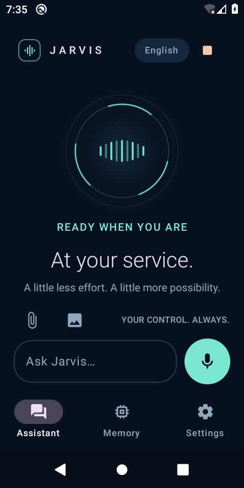
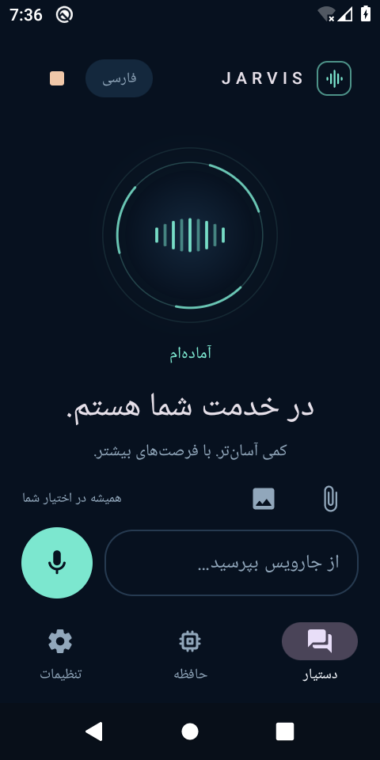

# Jarvis for Android

A native, dark-first voice assistant for English, Spanish, and Persian. Built for Android 10 or newer, with an ARM64 build suitable for testing on a Redmi 9.

This is a development build for personal testing. It provides a real Android app and real native speech/inference integrations; device performance, microphone recognition, and background reliability still need testing on the phone. See the delivered verification report for executed checks.

## Download for Android

[**Download Jarvis 0.1.1 APK — about 98 MB**](https://raw.githubusercontent.com/sepehrdadehsani89-hash/gdp-dashboard/jarvis-android-download/downloads/Jarvis-0.1.1-arm64.apk) · [Checksums and build details](downloads/build-info.json) · [Verification](docs/VERIFICATION.md)

 

## Start on your phone

1. Download the **APK**, not this source folder, using the download supplied with the delivery. Open it from your phone's Downloads app.
2. Android may ask you to allow that browser or file app to install unknown apps. Grant that specific installation permission if you choose to trust this development APK, then tap Install. You can revoke it afterward.
3. Open **Jarvis**, choose English, Español, or فارسی, and follow onboarding. You choose each permission; none is silently granted.
4. In **Settings**, download the selected language's offline speech model (about 40–55 MB). Test the microphone and voice. If the phone has no offline voice for that language, download its optional neural voice (about 60–70 MB).
5. For general conversation without an API key, choose the local provider and explicitly download the on-device Qwen model (about 400 MB). News, supported shortcuts, and explicit saved memories do not require that model or an API key.
6. After testing push-to-talk, enable wake listening from the visible app. Keep its microphone notification visible. Stop listening at any time using the app or notification controls.

No USB connection or computer is needed to install a supplied APK. Building from source is a separate workflow below.

## What this version offers

| Capability | Setup and practical limits |
| --- | --- |
| Spoken/typed conversation | Local Qwen inference after a model download; optional cloud providers require your own key. Small local models can be slow and make mistakes. |
| English, Spanish, Persian speech | Selected-language offline Vosk model; an installed offline system voice or downloaded neural voice. Language selection is explicit. |
| Wake phrases | **Hey Jarvis**, **Hola Jarvis**, **سلام جارویس**, matched in the selected listening language. Recognition accuracy depends on the voice/model/device. |
| News and YouTube | Internet-backed news with source links; YouTube search/navigation uses supported app intents. Source availability can change. |
| Memory | Explicit facts you ask Jarvis to remember, stored on the phone and removable in the Memory screen. |
| Apps and device context | Supported app launching, phone utilities, and optional contacts/calendar/location access. Sensitive mutations use an approval step or a system-owned draft. |
| Files, photos, and current screen | User-selected documents/photos and optional accessibility context, subject to the app's supported parsers and privacy limits. Android sandboxes remain in force. |
| Notifications | Optional Android notification-listener access; read access is a separate user decision. |
| Stop everything | Stops app-owned listening/speech/generation and cancels pending work. It cannot undo an action already completed in another app. |

Jarvis cannot silently access every app's private database, all photos, or every file. File and photo access uses user selection, and Android requires separate approval for sensitive permissions and special access. Banking/payment/password-manager automation is blocked. No root or permission bypass is used.

Wake listening is best effort. Android, force-stop, battery settings, and the phone manufacturer may stop it. This build does not start microphone capture automatically at boot. Reopen Jarvis and explicitly resume when necessary.

## No API key required

The default provider is local. A local language model, downloaded to private app storage, runs CPU inference on the phone. It does not need a paid account or a hosted API. Model and voice downloads require Internet initially; live news always requires Internet.

The Qwen 0.5B model is intentionally small for constrained devices. A Redmi 9 may need substantial time to generate a reply and can run out of memory when other apps are active. This is not equivalent to a large cloud model. Persian and Spanish quality must be evaluated on the device. See [local model details](docs/LOCAL_MODEL.md).

Optional OpenAI, Anthropic, and Gemini adapters are available for users who choose cloud processing and enter their own key privately in Settings. Keys are not bundled. A ChatGPT subscription does not automatically provide an API key or API credit. Choosing a cloud provider sends the relevant conversation context to that provider.

## Build from source

Install a full JDK 17 or 21 and the Android SDK packages listed in [compatibility](docs/COMPATIBILITY.md). Set `JAVA_HOME` and `ANDROID_HOME`; keep the project's Gradle Wrapper files.

Linux/macOS:

```bash
bash scripts/doctor.sh
bash scripts/build.sh
```

Windows PowerShell:

```powershell
.\scripts\doctor.ps1
.\scripts\build.ps1
```

The default build script runs debug assembly, JVM unit tests, and Android lint. The APK is produced at:

```text
app/build/outputs/apk/debug/app-debug.apk
```

The script prints a SHA-256 checksum. Debug signing is for development; it is not a production signing identity. No release key or private credential is included in source.

For an authorized USB/wireless-debugging device:

```bash
bash scripts/install.sh --serial DEVICE_SERIAL
# Or install an already built APK:
bash scripts/install.sh --serial DEVICE_SERIAL --apk /path/to/jarvis.apk
```

```powershell
.\scripts\install.ps1 -Serial DEVICE_SERIAL
.\scripts\install.ps1 -Serial DEVICE_SERIAL -Apk C:\Downloads\jarvis.apk
```

With exactly one authorized device, the serial argument may be omitted. The scripts refuse ambiguous selection, use `adb install -r`, and launch onboarding. They do not grant permissions, modify secure settings, or start a background microphone service.

Detailed SDK setup, direct-phone installation, wireless debugging, and troubleshooting: [installation guide](docs/INSTALL.md).

## Privacy and storage

- Conversation and explicit memories are stored in the app's private local database. This database is not advertised as encrypted merely because Android app storage is private.
- Provider keys use Android Keystore-backed encryption. They are not included in the APK, source, conversation prompts, or logs.
- Wake recognition uses the downloaded local model. An optional network speech fallback is separately disclosed and disabled by default.
- Offline TTS uses installed offline system voices or a verified downloaded neural voice. Optional cloud speech sends answer text to the selected service only when enabled.
- Model/voice files use private app storage. Removing the app removes its private data and downloads. A data-wipe control's exact scope is shown before confirmation.
- Permission revocation, battery settings, and force-stop remain under Android's control. Accessibility/notification access can be disabled in Android Settings.

## Compatibility, licenses, and verification

- [Pinned toolchain and build prerequisites](docs/COMPATIBILITY.md)
- [Phone installation and recovery](docs/INSTALL.md)
- [Local model provenance and constraints](docs/LOCAL_MODEL.md)
- [Speech models, licenses, and device checklist](docs/VOICE_MODELS.md)

Native components and model assets have different licenses. In particular, the neural speech stack includes eSpeak NG under GPLv3; it must not be described as an Apache-only dependency graph. Keep upstream notices and the corresponding source material with any redistributed build. See the speech-model document and supplied third-party sources/notices.

This delivery does not establish store approval, production readiness, physical-device battery life, voice quality, or universal third-party-app control. Automated checks, native compilation, emulator evidence, and unverified phone checks must remain distinct in the verification report.
