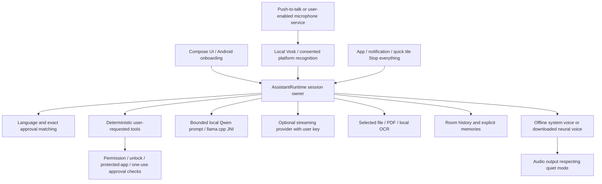

# Jarvis Android preview architecture

This app prioritizes a useful keyless path on a Redmi 9. Kotlin/Compose presents observable state from a process-scoped AssistantRuntime. Room persists conversation and explicitly saved facts; provider credentials are separately encrypted with Android Keystore. The native libraries are included, while large speech/voice/LLM models are explicit downloads.

The LLM has no direct action execution path. App intents and navigation require proposals registered by deterministic user-command handling, an exact current approval, and revalidation. A webpage, model response, notification, or file cannot create an executable proposal.

Private contacts, calendar and notification output are answered locally and are not replayed into cloud history. Explicit memories stay local unless the user enables sharing saved facts with the selected cloud AI. General conversation uses a bounded in-memory buffer. A separate, explicitly consented one-shot screen session supplies an image to Gemini or visible text to another selected provider; those turns never enter general history. User-selected attachment text is scoped to the current general question and the selection is cleared after reading; cloud processing occurs only when the user selects a cloud provider. The local model receives bounded, labeled, incomplete excerpts rather than a claim to consume entire long files.

One session generation guards asynchronous responses. New input cancels the previous job, local inference, cloud voice request, audio, and pending actions. Stop everything also stops the wake service and downloads. Data wipe waits for canceled jobs before deleting app-owned persistent state. Already completed external actions cannot be undone.

Wake listening uses local speech recognition and prefix matching in one selected language. It is not a measured low-power keyword classifier and is paused during responses; echo-resistant voice barge-in is not implemented. No boot microphone restart, overlay, arbitrary-app tapping, continuous screen recording, automatic private-file scanning, or silently granted permission is claimed.

The default phone artifact is ARM64/API29+, with a separate x86_64 build used for emulator checks. Physical Redmi microphone recognition, pronunciation quality, background endurance, memory/thermal survival, and latency remain device tests. The release is an early development preview, not a production/store readiness claim.

Speech destinations are authorized separately from language-model destinations. AssistantReply denies cloud speech by default. The runtime can allow the user-enabled cloud voice only for general AI responses without private attachment/memory context; model-generated text cannot change that flag.

Version 0.1.3 uses a short non-streamed provider check, a visible success/failure modal, and a bounded request deadline. Regular responses still stream; a sentence buffer feeds a cancellable local speech queue before generation finishes. The one-shot capture Activity obtains disclosure/Android consent, a mediaProjection foreground service reads one ImageReader frame, and ScreenSession holds its bounded JPEG for follow-up questions. Private screen/file/memory replies cannot use cloud speech. Optional locked general chat has no identity or private context. Android/MIUI endurance and real network latency remain physical-device checks.
